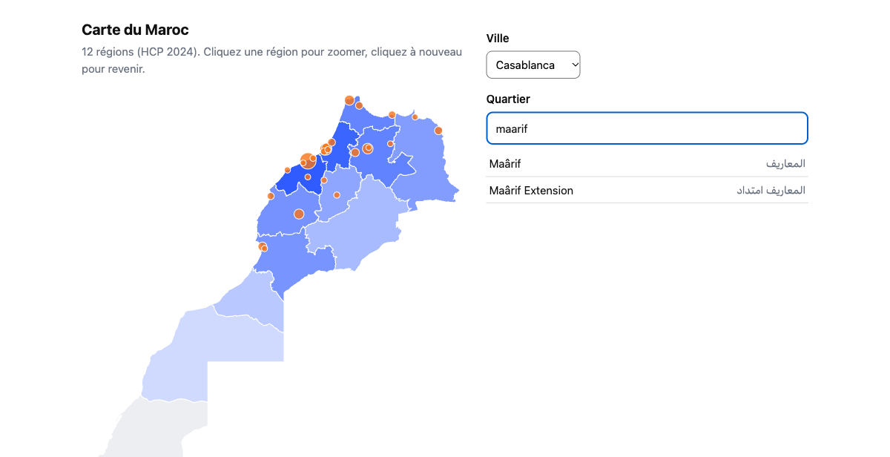
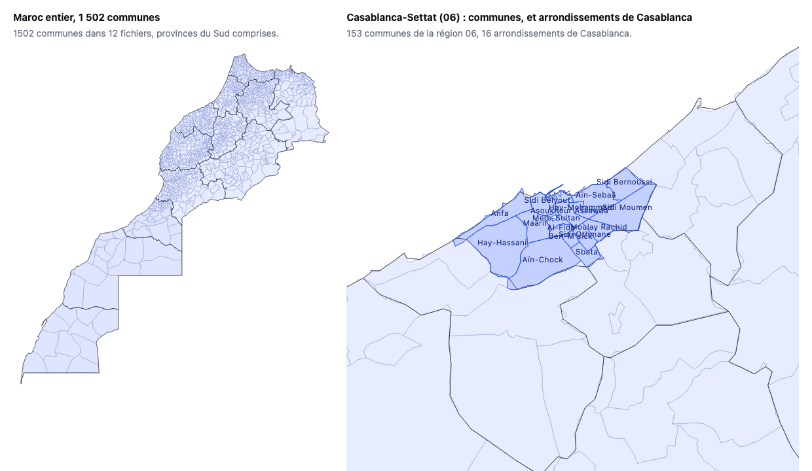

# maroc-geo

Géographie du Maroc prête à l'emploi pour les formulaires de commande, la livraison et les tableaux de bord : régions, provinces et communes (HCP, recensement 2024), 391 villes en français et en arabe, les quartiers de 14 grandes villes, une carte du Maroc (TopoJSON + d3) et une recherche qui pardonne les fautes de frappe.

*English summary at the bottom.*



## Ce qu'il y a dedans

| Fichier | Contenu | Source | Licence |
|---|---|---|---|
| `data/regions.json` | 12 régions, code HCP (`"01"` à `"12"`), nom FR et AR | HCP, RGPH 2024 | CC BY 4.0 |
| `data/provinces.json` | 75 provinces et préfectures, code HCP (`"06.141"`), région, FR, AR | HCP, RGPH 2024 | CC BY 4.0 |
| `data/communes.json` | 1 503 communes et arrondissements, code, province, FR, AR, population 2024 | HCP, RGPH 2024 | CC BY 4.0 |
| `data/cities.json` | 391 villes pour les formulaires d'adresse (liste de JMLA Pro), FR, AR, code région | compilation Zonemation | CC BY 4.0 |
| `data/cities-geonames.json` | 180 villes de plus de 15 000 habitants avec coordonnées et noms alternatifs | GeoNames | CC BY 4.0 |
| `data/neighbourhoods.json` | 5 791 quartiers dans 14 villes (407 « principaux »), FR, AR quand une source le donne, alias, source de chaque entrée | Barid Al-Maghrib, OpenStreetMap, Wikipédia, Wikidata | **ODbL 1.0** |
| `data/map/communes-01…12.topo.json` | Formes des 1 502 communes, un fichier par région (17 à 150 Ko) | OpenStreetMap, codes HCP | **ODbL 1.0** |
| `data/map/arrondissements.topo.json` | 41 arrondissements : Casablanca 16, Fès 6, Rabat 5, Salé 5, Marrakech 5, Tanger 4 | OpenStreetMap, codes HCP | **ODbL 1.0** |
| `data/morocco.topo.json` | Frontières des 75 provinces et des 12 régions qui en sont dissoutes (60 Ko), clés = codes HCP | OpenStreetMap via [morocco-map](https://github.com/yousfiSaad/morocco-map), codes HCP | **ODbL 1.0** |

La carte représente le Maroc dans ses frontières complètes, provinces du Sud comprises (régions de Guelmim-Oued Noun, Laâyoune-Sakia El Hamra et Dakhla-Oued Ed-Dahab), selon le découpage officiel du HCP.

Les 14 villes avec quartiers sont : Casablanca, Rabat, Salé, Témara, Mohammédia, Marrakech, Fès, Meknès, Tanger, Tétouan, Agadir, Oujda, Kénitra et El Jadida.

## Installation

Le paquet n'est pas encore publié sur npm. Installez-le depuis GitHub :

```sh
npm install github:stntr660/maroc-geo
```

Vous pouvez aussi copier simplement les fichiers de `data/`, qui sont du JSON brut utilisable dans n'importe quel langage.

## Utilisation

### Chercher une ville (champ « Ville » d'un formulaire)

```ts
import { findCities } from "maroc-geo";

findCities("casa");     // [{ id: 23, fr: "Casablanca", ar: "الدار البيضاء", region: "06" }, ...]
findCities("fez");      // Fes
findCities("marakech"); // Marrakech (une faute tolérée tous les 4 caractères)
findCities("طنجة");     // Tanger
findCities("");         // les 16 grandes villes d'abord, puis toutes les autres de A à Z
```

La recherche ignore les accents, les variantes de l'arabe (hamza, taa marbouta, harakat) et reconnaît les surnoms courants (casa, fdala, tanja, mazagan…).

### Placer une ville saisie librement (tableaux de bord)

```ts
import { placeCity, placeRegion, aggregateByPlace } from "maroc-geo";

placeCity("Fès");        // { region: "03", province: "03.251" }
placeCity("فاس");        // même résultat
placeCity("Rissani");    // { region: "08", province: "08.201" } (alias vers le nom du recensement)
placeCity("n'importe");  // null : on ne devine jamais

placeRegion("Marrakesh-Safi"); // "07" (noms anglais des services de géolocalisation acceptés)

const { regions, provinces, unplaced } = aggregateByPlace(
  orders.map((o) => ({ city: o.city, values: { orders: 1, revenue: o.total } })),
  ["orders", "revenue"],
);
```

### Quartiers (champ « Quartier » du checkout)

Les quartiers pèsent environ 1 Mo. Lisez-les côté serveur et n'envoyez au navigateur que la ville demandée :

```ts
// app/api/neighbourhoods/route.ts (Next.js)
import { neighbourhoodsFor } from "maroc-geo/neighbourhoods";

export function GET(req: Request) {
  const city = new URL(req.url).searchParams.get("city") ?? "";
  const list = neighbourhoodsFor(city); // { main, all } ou null
  return Response.json(list ?? { main: [], all: [] }, { status: list ? 200 : 404 });
}
```

```ts
import { searchNeighbourhoods } from "maroc-geo/neighbourhoods";
searchNeighbourhoods(list, "maarif"); // [{ fr: "Maârif", ar: "المعاريف", aliases: [...] }, ...]
searchNeighbourhoods(list, "");       // list.main : les quartiers connus, à montrer au défilement
```

`main` contient les quartiers principaux, ceux que le client voit en premier. `all` contient la liste complète, pour la recherche. Un composant React prêt à copier se trouve dans [`react/NeighbourhoodField.tsx`](react/NeighbourhoodField.tsx). Il accepte aussi un quartier absent de la liste, parce qu'aucune liste n'est complète.

### Carte

```ts
import { layoutMorocco, CITY_POINTS } from "maroc-geo/map";

const map = layoutMorocco(520, 560, "regions"); // ou "provinces"
map.shapes;           // features GeoJSON, properties { code, region }
map.path(shape);      // attribut d d'un <path> SVG
map.borders;          // frontières intérieures en un seul tracé
map.project(-7.61, 33.59); // [x, y] d'un point (lng, lat)
map.viewBoxFor("06"); // viewBox pour zoomer sur une région
```

La carte descend jusqu'aux communes et aux arrondissements. Ces couches se chargent à la demande, une région à la fois :

```ts
import { layoutMorocco, loadCommunes, loadArrondissements, layoutLayer } from "maroc-geo/map";

const base = layoutMorocco(520, 560);
const communes = layoutLayer(base, await loadCommunes("06"));   // 153 communes de Casablanca-Settat
const arrdts = layoutLayer(base, await loadArrondissements()); // 41 arrondissements
communes.viewBoxFor("06.141.01.0"); // zoom sur la commune de Casablanca
```

Toutes les couches utilisent la même projection et se superposent dans un seul `<svg>`. Le détail est dans [docs/MAP.md](docs/MAP.md), avec les taux de correspondance et les limites connues. Il n'y a qu'un manque : la commune de Sidi Mohamed Benmansour (Kénitra) n'a pas de limite tracée dans OSM.



Pour React, [`react/MoroccoMap.tsx`](react/MoroccoMap.tsx) affiche une carte choroplèthe : régions colorées selon une valeur, bulles de villes, clic pour zoomer.

```tsx
<MoroccoMap values={{ "06": 120, "07": 40 }} cities={[{ name: "Casablanca", lat: 33.59, lng: -7.61, value: 90 }]} format={(v) => `${v} commandes`} />
```

Les fichiers de `react/` ne sont pas compilés avec le paquet : copiez-les dans votre application et adaptez le style.

### Démo

```sh
npx serve .   # puis ouvrez /examples/ (régions + quartiers) et /examples/fine.html (communes + arrondissements)
```

## Qualité des données des quartiers

Chaque quartier garde sa source dans le champ `src` (page de l'annuaire, objet OSM, page Wikipédia). L'arabe n'est rempli que si une source le donne : rien n'a été traduit à la main ni par une IA.

Un quartier entre dans `main` s'il remplit au moins un critère vérifiable :
- zone de livraison d'un transporteur (`ozon: true`, Casablanca) ;
- arrondissement officiel ;
- `place=suburb` ou `place=quarter` dans OSM ;
- présence dans la liste des quartiers de l'article Wikipédia de la ville ;
- présence à la fois dans l'annuaire et dans OSM.

Ont été retirés de la liste : les blocs, les immeubles, les zones industrielles, les équipements et les entrées sans nom.

Limites connues :
- l'annuaire Barid date de 2012, donc les quartiers récents manquent quand OSM ne les a pas ;
- l'arabe est pauvre à Tétouan, Mohammédia, El Jadida et Kénitra ;
- quelques cas restent à trancher : El Menzeh, Ouislane / Toulal, Triangle d'Or, et des listes `main` courtes à Témara et Mohammédia.

Les corrections sont les bienvenues : ouvrez une issue ou une pull request en citant une source.

## Développement

```sh
npm install
npm test        # compile puis lance les tests (node:test)
```

## Licences

- **Code** : MIT, voir [LICENSE](LICENSE).
- **Données** : chaque fichier garde la licence de sa source. Voir [DATA-LICENSES.md](DATA-LICENSES.md) pour les attributions à reproduire. En résumé, `neighbourhoods.json` et `morocco.topo.json` sont sous **ODbL 1.0**, car ils sont dérivés d'OpenStreetMap : si vous redistribuez une base qui en est dérivée, elle doit rester sous ODbL et citer « © les contributeurs d'OpenStreetMap ». Les autres fichiers sont sous **CC BY 4.0** et demandent de citer la source.

---

## English summary

Ready-to-use Moroccan geography for checkout forms, delivery and dashboards:
- 12 regions, 75 provinces and 1,503 communes with official HCP census codes and 2024 population ;
- 391 towns in French and Arabic ;
- 5,791 neighbourhoods in 14 major cities, each with its source ;
- a TopoJSON map of Morocco down to its 1,502 communes and 41 arrondissements, with d3 helpers and React components ;
- search that tolerates missing accents, Arabic spelling variants, nicknames ("casa", "fez") and typos.

To install, run `npm install github:stntr660/maroc-geo`. The code is under MIT. The data keeps its sources' licences: CC BY 4.0, except the neighbourhoods and the map, which are under ODbL 1.0 because they derive from OpenStreetMap. See [DATA-LICENSES.md](DATA-LICENSES.md).
