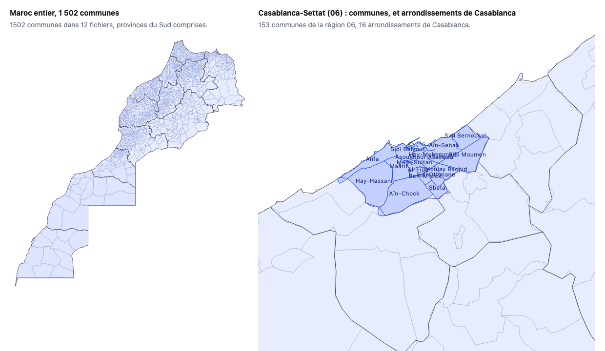

# Map layers

maroc-geo draws Morocco whole, Southern Provinces included (regions 10 Guelmim-Oued Noun, 11 Laâyoune-Sakia El Hamra, 12 Dakhla-Oued Ed-Dahab), following the HCP's official division. No layer contains a separate "Western Sahara" shape.



## Layers

| Layer | File | Shapes | Properties | Size |
|---|---|---|---|---|
| Regions | `data/morocco.topo.json`, object `regions` | 12 | `{ code, region }` | 60 KB (with provinces) |
| Provinces / préfectures | `data/morocco.topo.json`, object `provinces` | 75 | `{ code, region }` | (same file) |
| Communes | `data/map/communes-<region>.topo.json`, object `communes` | 1 502 of 1 503, in 12 files | `{ code, province, region, fr, ar }` | 17 to 150 KB per file, 1.0 MB in all |
| Arrondissements | `data/map/arrondissements.topo.json`, object `arrondissements` | 41 of 41 | `{ code, commune, city, fr, ar }` | 32 KB |

Codes are HCP RGPH 2024 codes: region `"06"`, province `"06.141"`, commune `"06.141.01.0"`, arrondissement `"06.141.01.03"`. The communes and arrondissements carry the same codes as `data/communes.json`, so you can join them to any data you keep per commune.

Commune file sizes (KB): 01: 98 · 02: 98 · 03: 125 · 04: 81 · 05: 78 · 06: 92 · 07: 150 · 08: 78 · 09: 103 · 10: 34 · 11: 18 · 12: 17.

Arrondissements exist for six communes: Casablanca (16), Fès (6), Rabat (5), Salé (5), Marrakech (5) and Tanger (4).

## Use

```js
import { layoutMorocco, loadCommunes, loadArrondissements, layoutLayer } from "maroc-geo/map";

const base = layoutMorocco(520, 560, "provinces");   // the projection every layer shares
const communes = await loadCommunes("06");          // Casablanca-Settat only
const arr = (await loadArrondissements()).filter((a) => a.properties.city === "Casablanca");

const c = layoutLayer(base, communes);
const a = layoutLayer(base, arr);
// <svg viewBox={c.viewBoxFor()}> … base.shapes, c.shapes, a.shapes, all drawn with base.path
c.path(communes[0]);              // d attribute of a <path>
a.viewBoxFor("06.141.01.01");     // zoom on Anfa
```

All layers use the projection of `layoutMorocco()`, so they nest in one `<svg>` and one `viewBox` zooms them together.

### Loading the files

`loadCommunes()` and `loadArrondissements()` use `import(…, { with: { type: "json" } })` on literal paths, one per file:

- **Node 20.10+**: works as is (this is what the tests use).
- **Vite, Rollup, webpack 5, esbuild, Next.js**: each file becomes its own chunk, loaded only when that region is asked for. Nothing to configure if the bundler accepts JSON imports (all of these do by default).
- **CDN or your own server**: pass a loader and the files are fetched instead of bundled:

```js
const fromCdn = (file) => fetch(`https://cdn.jsdelivr.net/npm/maroc-geo/data/map/${file}`).then((r) => r.json());
const communes = await loadCommunes("06", fromCdn);
```

The raw TopoJSON files can also be used directly with `topojson-client`: `feature(topo, topo.objects.communes)`.

## How the layers are built

Run only when a source changes; the outputs are committed.

```sh
# 1. sources
curl -L -o morocco-latest.osm.pbf https://download.geofabrik.de/africa/morocco-latest.osm.pbf
npm pack morocco-communes@1.9.1 && tar -xzf morocco-communes-1.9.1.tgz   # -> package/

# 2. extract every admin boundary (needs pyosmium + shapely, e.g. in a venv)
python3 -m venv .venv && .venv/bin/pip install osmium shapely
.venv/bin/python scripts/build-fine-map.py morocco-latest.osm.pbf admin.geojson

# 3. match to HCP codes, simplify (npx mapshaper@0.7), split per region, write data/map/
OSM_TIMESTAMP=2026-11-18 node scripts/build-fine-map.mjs admin.geojson package
```

- Geofabrik's `morocco` extract covers the whole Kingdom: its clipping polygon (`https://download.geofabrik.de/africa/morocco.poly`) goes down to 20.4° N. The current data comes from the extract of 2026-11-18.
- In OpenStreetMap's Moroccan tagging, `admin_level=4` is the region, `5` the province or préfecture, `8` the commune, `9` the préfecture d'arrondissements of Casablanca and `10` the arrondissement. Communes and arrondissements carry the HCP code in `ref:MA:HCP`.
- Simplification: communes with `-simplify interval=120` (metres) on the whole country at once, so borders between regions stay shared, then split per region; arrondissements with `interval=25`. Quantization 1e5.

### Matching

Each OSM shape is matched to an HCP code in this order. There is no fuzzy matching: a shape that fits none of the rules is left out and listed.

1. **ref**: `ref:MA:HCP` (trailing dot removed) equals an HCP code, and the French or Arabic names agree after normalisation (accents, Arabic letter variants, "Arrondissement de", "Bni/Beni", "Ouled/Oulad"…), equal or one containing the other.
2. **alias**: the ref equals an HCP code and the OSM name is a spelling checked by hand and listed in `ALIAS_BY_CODE` in `scripts/build-fine-map.mjs` (for example "Ahermoumou", renamed Ribate El Kheir; "Timhadit" for Timahdite).
3. **name**: no usable ref, but the same normalised name as an HCP commune of the province the shape lies in.
4. **ref-only**: the ref matches but the names disagree; kept and listed for review.

The details of each build (methods, missing codes, unmatched OSM shapes, shapes whose interior point falls in another province of the base map) are in `data/map/match-report.json`.

### Match rates (build of 2026-11-18)

| Layer | With a shape | ref | alias | name | ref-only |
|---|---|---|---|---|---|
| Communes | **1 502 / 1 503** (99.9 %) | 1 488 | 14 | 0 | 0 |
| of which Southern Provinces (regions 10–12) | 86 / 86 | | | | |
| Arrondissements | **41 / 41** | 41 | 0 | 0 | 0 |

No OSM commune inside Morocco is left unmatched. The 8 unmatched shapes at the arrondissement levels are Casablanca's préfectures d'arrondissements (`admin_level=9`), which group arrondissements and are not a layer here.

## Known gaps

- **Sidi Mohamed Benmansour** (`04.281.05.11`, province of Kénitra) has no shape: its OSM relation (r5962436) has only an admin-centre node and no boundary ways. Its area shows as a hole between its neighbours. It will appear when someone maps the boundary in OSM and the build is re-run.
- The communes come from a newer OSM state than the provinces of `morocco.topo.json` (morocco-map@1.3.0) and are simplified separately, so commune edges and province edges do not coincide exactly; at country scale the gap is under a pixel, at city scale it is visible as a thin offset. Two communes (`05.255.09.03` Bni Chegdale, `04.491.01.09` Sidi Yahia El Gharb) have their interior point in a neighbouring province of the base map; their HCP province is kept.
- OSM commune boundaries follow the coastline (with ports and jetties), not the territorial sea.
- The geometry is as accurate as OSM contributors made it; it is not an official cadastral boundary.

## Licences

- **Geometry of every layer: ODbL 1.0, © OpenStreetMap contributors** (https://www.openstreetmap.org/copyright). The communes and arrondissements files are derived databases of OpenStreetMap: if you redistribute them or a database derived from them, keep it under ODbL and keep the attribution "© OpenStreetMap contributors". Maps you render from them (images, web maps) only need the attribution.
- Codes and names: Haut-Commissariat au Plan, RGPH 2024, via morocco-communes@1.9.1 (data CC BY 4.0); credit the HCP.
- Build scripts and `src/map.ts`: MIT, like the rest of the package.
